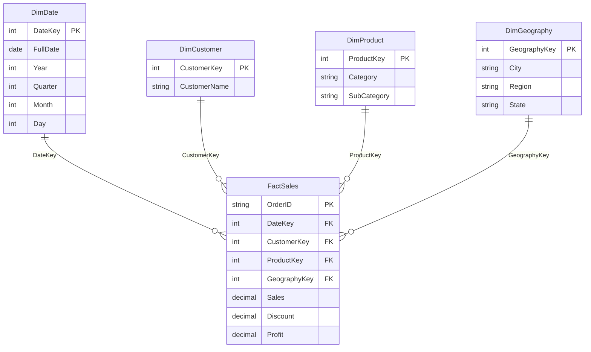

# Grocery sales data model

This is a proposed logical star schema for the source CSV. The Python and SQL
analysis scripts currently analyze the flat source data directly; they do not
create these dimension and fact tables.

## Grain

One row in `FactSales` represents one source CSV row. The CSV has 9,994 rows and
9,994 distinct `Order ID` values, so `Order ID` is unique in this dataset and
can be retained as a degenerate transaction identifier in the fact table.

## Entity relationship diagram (ERD)

The diagram uses crow's-foot notation: each dimension member can relate to zero
or many `FactSales` rows, while each fact row references exactly one member
from each dimension.

Each dimension has a one-to-many relationship with `FactSales`: a dimension
member can describe many fact rows, and each fact row references one member in
each dimension. `OrderID` remains in the fact table as a degenerate dimension;
the source contains no separate order attributes that require a `DimOrder`.

## Source-to-model mapping

| Fact or dimension | Source columns | Model use |
| --- | --- | --- |
| `FactSales` | `Order ID`, `Sales`, `Discount`, `Profit` | Transaction identifier and numeric measures. |
| `DimDate` | `Order Date` | Parse to a calendar date; derive date attributes such as year, quarter, month, and day. |
| `DimCustomer` | `Customer Name` | Customer label. The source has 50 distinct names. |
| `DimProduct` | `Category`, `Sub Category` | Product grouping; the source has 23 distinct category/subcategory pairs. |
| `DimGeography` | `City`, `Region`, `State` | Sales geography; the source has 97 distinct city/region/state combinations. |

Use integer surrogate keys for the dimensions in a physical warehouse. The
source columns map to dimension rows during an ETL/load step; they are not
foreign keys themselves.

## Modeling limitations

- The source has customer names but no customer IDs. Names are not guaranteed
  to identify real people uniquely, so `DimCustomer` is only a name-based
  grouping, not a verified customer entity.
- The source has categories and subcategories but no product or SKU IDs.
  `DimProduct` therefore represents product groups, not individual items.
- `Discount` is a rate and should not be summed like `Sales` or `Profit`.
  Profit margin is a derived measure; calculate it as total profit divided by
  total sales for a group rather than averaging row-level margins when
  reporting a weighted margin.
- The source uses mixed date formats. Normalize `Order Date` before assigning
  `DateKey`; the project scripts treat hyphenated dates as day-month-year and
  slash-formatted dates as month/day/year.
